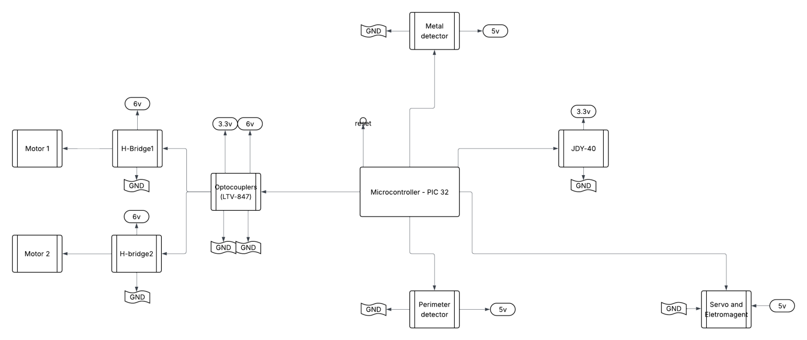

# Autonomous Coin Picking Robot

An embedded robot with manual and automatic modes for detecting and collecting metal coins.

## Features

- Wireless joystick control through JDY-40 UART modules.
- Automatic navigation with perimeter detection.
- Metal detection using a Colpitts oscillator.
- Electromagnetic pickup with two servo motors.
- Frequency feedback through an LCD and buzzer.

## Hardware

| Component | Purpose |
| --- | --- |
| STM32L051 | Handheld controller |
| PIC32MX130 | Robot controller |
| JDY-40 modules | Wireless serial communication |
| Joystick and push buttons | Manual input and mode selection |
| Gear motors | Robot movement |
| Servo motors and electromagnet | Coin pickup |
| Oscillator and detector circuits | Metal and boundary sensing |
| LCD and buzzer | Feedback |

## Code Layout

- `AssembledRobotics[Complete Code]/controller.c`: integrated handheld controller firmware.
- `AssembledRobotics[Complete Code]/robot.c`: integrated robot firmware.
- `Common/`: MCU headers, startup code, serial support and linker scripts.
- `Joystick/`, `Master/` and `STM32_JDY40_test_Master/`: controller modules and tests.
- `Metal_Detector/`, `Peak_detector/`, `Servo/`, `motor/` and `pwm/`: hardware subsystem tests.
- `extracode/`, `run/` and `Versions/`: alternative implementations and experiments.
- `stm32flash/`: STM32 programming utility and its bundled components.

## Controls

### Manual mode

Use the joystick to move the robot, the pickup button to collect a coin, and the mode button to select automatic operation.

### Automatic mode

The robot searches for coins, responds to boundary sensors and activates the pickup mechanism when metal is detected. The collection routine stops after 20 coins.

## Building and Programming

Each buildable subsystem contains its own makefile. The controller projects require an ARM embedded toolchain; PIC32 projects require the Microchip XC32 toolchain. Review the selected makefile and serial-port configuration before building or flashing hardware.

Generated object files, debugging executables, dependency files and linker maps are excluded from version control. Existing `.hex` firmware files are retained.
